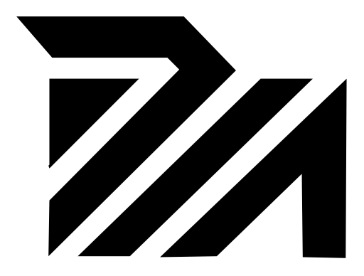

<div align="center">

<picture>
  <source media="(prefers-color-scheme: dark)" srcset="brand/png/powm-mark-white-512.png">
  
</picture>

# PowMachina

**A proof-of-work chain where the CPU and the GPU each hold a guaranteed share of the emission.**

Not by hoping for a "fair" algorithm — through consensus. Two mining lanes, separate difficulty,
the same block weight. An ASIC would have to cover two opposing hardware domains at once; covering
one earns it half the emission at most.

[](LICENSE)
[](go.mod)
[](#the-two-lanes)
[](#the-numbers)
[](https://powmachina.com)

</div>

---

## The two lanes

|  | algorithm | runs on |
|---|---|---|
| **lane C** | **MachinaHash-C** — RandomX v2 with the PowMachina salt | the CPU |
| **lane G** | **MachinaHash-G** — a B-core over an epoch DAG | the GPU |

Each lane has its own difficulty target and both produce blocks of the same weight, so neither can
crowd the other out. A miner runs both at once if it has the hardware for both.

## The numbers

|  |  |
|---|---|
| Ticker | **POWM** |
| Addresses | `powm1q…` — bech32m (testnet `tpowm1q…`, regtest `rpowm1q…`) |
| Block time | 30 s, so 60 s per lane · block at most 96 kB + the shares it settles |
| Finality | the miners of the last day (2,880 blocks), more than 2/3 of their weight, at a depth of 80 blocks (~40 min) |
| Max supply | 84,000,000 POWM · halving every 4 years |
| Premine | **none** — block one pays 0.10 POWM instead of 10 |
| Dev fee | 5 % of the subsidy to height 2,100,000 (~2 years), then nothing |

> **The specification, the algorithm, finality and the operating guides are published at
> [powmachina.com](https://powmachina.com).** This repository is the source.

---

## Running a node

Take a binary from [Releases](../../releases) — there is nothing to install.

```sh
./powmachinad -testnet -datadir ~/.powmachina
```

Without a network flag the node refuses to start: the mainnet genesis does not exist yet.
`-regtest` gives you a private chain to play with.

```sh
./powmachinad -regtest -datadir ~/.powm -mine 4
```

**Use `-datadir`.** Without it the chain lives in memory only and a restart means a full resync.
The node says so at startup.

## Mining

`powmachina-miner` works both lanes at once — lane C on the CPU, lane G on every NVIDIA card it
finds. Solo against your own node, or to a pool over stratum.

```sh
powmachina-miner --benchmark 60s                        # what this machine can do
powmachina-miner --pool stratum+tcp://host:7699 --address powm1… --worker rig1
POWM_RPC_TOKEN=… powmachina-miner --address powm1…      # solo, against your own node
```

The GPU side needs an NVIDIA driver 580 or newer and the `powm-cuda` plugin next to the binary;
releases ship it. **At every epoch the miner re-checks the card against the reference
implementation** and switches off a card that disagrees, so it never mines blocks the network
would reject.

## The wallet

The node holds no keys. The wallet is a separate program, as in Monero — a terminal client, an RPC
service for exchanges, and a desktop app.

```sh
powmachina-wallet-cli --generate-new-wallet mine    # a password twice, then 24 words
powmachina-wallet-cli --wallet-file mine
```

Back up the **24 words**, and the wallet file too once you import a private key.

---

## Building it

One command. Beyond Go the only thing you need is a C compiler.

```sh
./build.sh          # or: make
./bin/powmachinad -selfcheck
```

**[BUILDING.md](BUILDING.md)** covers the GPU plugin on both systems, the desktop wallet, Docker
and how a release is signed.

### One language, one implementation

`internal/mh` is the only implementation of MachinaHash in the project. The node calls it
directly, so does the miner, and the CUDA kernel is held against it by test vectors. A second copy
of the proof of work, differing by a single constant, is a chain split — which is how a number of
small coins have died.

The check sits in the repository: `internal/mh/mh_test.go` verifies **1,000 test vectors**. The
vectors are the contract, not the code: anything that computes the proof of work has to reproduce
them without a single change. That is exactly what they are for.

RandomX is C++ and **is not rewritten here** — it is vendored, pinned to a commit and compiled
through cgo as part of `go build`
([VENDOR-RANDOMX.md](internal/randomx/csrc/VENDOR-RANDOMX.md)). A second test holds that we compile
it correctly: with the stock salt it must produce exactly the hashes upstream does
(`make conformance`).

## What is in here

```
cmd/powmachinad/                  the node
cmd/powmachina-miner/             the miner, both lanes
cmd/powmachina-wallet-cli/        the wallet, terminal
cmd/powmachina-wallet-rpc/        the wallet as a service (exchanges, the desktop app)
cmd/powmachina-explorer/          the block explorer
cmd/libmachinahash/               a C ABI, so pool software never rebuilds consensus bytes itself
cmd/mh-*/                         calibration and test-vector tools
cmd/powm-*sim/                    simulators the consensus numbers were picked with

internal/mh/                      MachinaHash — the only implementation
internal/randomx/csrc/            the vendored RandomX upstream
internal/chain/                   consensus: the header, emission, difficulty, the lane rules, the Sharepool
internal/store/                   storage (Pebble) — it survives kill -9
internal/blocksync/               bodies pulled in parallel from several sources

machinahash-cuda/                 the lane G CUDA kernel, bit-exact against the vectors
gui/                              the desktop wallet (Tauri)
vectors/                          the test vectors — the algorithm's contract
```

## Status

The chain runs on a testnet. Before mainnet: the genesis and the seed domains.

## Contributing

Read [CONTRIBUTING.md](CONTRIBUTING.md) first — it is short. A security bug does **not** go into a
public issue or pull request; [SECURITY.md](SECURITY.md) says where to send it.

## Licence

**BSD 3-clause** — see [`LICENSE`](LICENSE).

**MachinaHash-C** stands on **RandomX** by tevador and the Monero Project (BSD-3 as well), vendored
in `internal/randomx/csrc/randomx/`. The only change from upstream is the Argon2 salt, so the
hashes are not identical to stock RandomX. The third-party copyright notice is in
[`NOTICE`](NOTICE), and it travels with the binaries, not only with the sources.

PowMachina is in no way endorsed by or affiliated with the authors of RandomX or the Monero
Project.
